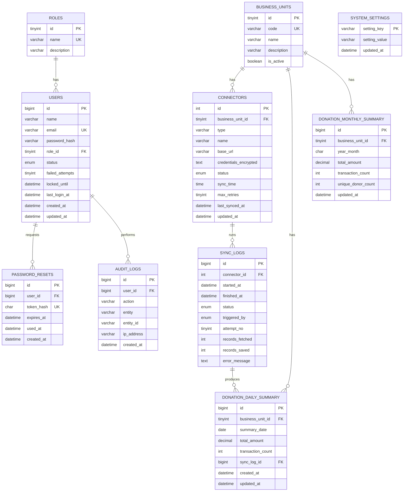

# KagumPulse: Requirement Pangkalan Data

| Perkara | Butiran |
|---|---|
| DBMS | MySQL 8 (InnoDB, `utf8mb4_unicode_ci`) |
| Zon waktu | Simpan dalam UTC; paparan Asia/Kuala_Lumpur |
| Skop | MVP (TBQ Amal) dengan skema sedia untuk unit lain |
| Prinsip utama | **Data agregat sahaja. Tiada PII penderma.** |

---

## 1. Prinsip Reka Bentuk

| # | Prinsip | Sebab |
|---|---|---|
| 1 | Simpan agregat (jumlah, bilangan) sahaja | PDPA (BR12) |
| 2 | Buang PII dalam memori sebelum tulis ke DB | BR13 |
| 3 | Skema generik berasaskan `business_units` | Boleh tambah Prosilat/Kagum Digital tanpa ubah skema (NFR-16) |
| 4 | Upsert pada kunci unik (unit, tarikh) | Elak duplikasi (BR20) |
| 5 | Simpan ringkasan harian **dan** bulanan | Penderma unik tidak boleh dijumlahkan daripada harian |
| 6 | Rahsia disulitkan pada aras aplikasi | NFR-06 |
| 7 | Soft-deactivate pengguna (bukan padam) | Rekod audit kekal (BR06) |

**Perhatian PII:** jangan simpan emel/ID penderma, walaupun dalam bentuk hash. Hash yang boleh dipadankan kembali masih dikira data peribadi yang dipseudonim-kan. Kira penderma unik dalam memori dan simpan **kiraan sahaja**.

---

## 2. ERD



---

## 3. Kamus Data

### 3.1 `roles`

| Lajur | Jenis | Kekangan | Penerangan |
|---|---|---|---|
| id | TINYINT UNSIGNED | PK, AI | |
| name | VARCHAR(30) | UNIQUE, NOT NULL | `owner`, `admin` (Fasa 2: `manager`, `data_entry`) |
| description | VARCHAR(150) | NULL | |

### 3.2 `users`

| Lajur | Jenis | Kekangan | Penerangan |
|---|---|---|---|
| id | BIGINT UNSIGNED | PK, AI | |
| name | VARCHAR(100) | NOT NULL | |
| email | VARCHAR(150) | UNIQUE, NOT NULL | Huruf kecil |
| password_hash | VARCHAR(255) | NOT NULL | bcrypt/argon2 |
| role_id | TINYINT UNSIGNED | FK → roles.id, NOT NULL | Satu peranan (BR02) |
| status | ENUM('active','inactive') | DEFAULT 'active' | BR06 |
| failed_attempts | TINYINT UNSIGNED | DEFAULT 0 | BR08 |
| locked_until | DATETIME | NULL | Kunci sementara |
| last_login_at | DATETIME | NULL | |
| created_at / updated_at | DATETIME | | |

### 3.3 `password_resets`

| Lajur | Jenis | Kekangan | Penerangan |
|---|---|---|---|
| id | BIGINT UNSIGNED | PK, AI | |
| user_id | BIGINT UNSIGNED | FK → users.id, ON DELETE CASCADE | |
| token_hash | CHAR(64) | UNIQUE, NOT NULL | SHA-256 token; token asal tidak disimpan |
| expires_at | DATETIME | NOT NULL | 60 minit |
| used_at | DATETIME | NULL | Sekali guna |
| created_at | DATETIME | | |

### 3.4 `business_units`

| Lajur | Jenis | Kekangan | Penerangan |
|---|---|---|---|
| id | TINYINT UNSIGNED | PK, AI | |
| code | VARCHAR(30) | UNIQUE, NOT NULL | `TBQ_AMAL`, `PROSILAT`, `KAGUM_DIGITAL` |
| name | VARCHAR(100) | NOT NULL | |
| description | VARCHAR(255) | NULL | Sahkan teks dengan Kagum |
| is_active | BOOLEAN | DEFAULT FALSE | Hanya TBQ Amal `TRUE` dalam MVP |

### 3.5 `connectors`

| Lajur | Jenis | Kekangan | Penerangan |
|---|---|---|---|
| id | INT UNSIGNED | PK, AI | |
| business_unit_id | TINYINT UNSIGNED | FK → business_units.id | |
| type | VARCHAR(30) | NOT NULL | `woocommerce` (Fasa 2: `csv`, `gsheet`) |
| name | VARCHAR(100) | NOT NULL | |
| base_url | VARCHAR(255) | NOT NULL | URL kedai |
| credentials_encrypted | TEXT | NOT NULL | Key + Secret disulitkan (AES-256 melalui `APP_KEY`) |
| status | ENUM('active','inactive') | DEFAULT 'inactive' | |
| sync_time | TIME | DEFAULT '02:00:00' | BR17 |
| max_retries | TINYINT UNSIGNED | DEFAULT 3 | BR18 |
| last_synced_at | DATETIME | NULL | Sync **berjaya** terakhir (label dashboard) |
| updated_at | DATETIME | | |

### 3.6 `sync_logs`

| Lajur | Jenis | Kekangan | Penerangan |
|---|---|---|---|
| id | BIGINT UNSIGNED | PK, AI | |
| connector_id | INT UNSIGNED | FK → connectors.id | |
| started_at / finished_at | DATETIME | | |
| status | ENUM('running','success','failed') | NOT NULL | |
| triggered_by | ENUM('schedule','manual') | NOT NULL | |
| attempt_no | TINYINT UNSIGNED | DEFAULT 1 | 1 hingga 3 |
| records_fetched | INT UNSIGNED | DEFAULT 0 | Bilangan transaksi ditarik (kiraan sahaja) |
| records_saved | INT UNSIGNED | DEFAULT 0 | Bilangan baris ringkasan ditulis |
| error_message | TEXT | NULL | Jangan sertakan data peribadi |

### 3.7 `donation_daily_summary`

| Lajur | Jenis | Kekangan | Penerangan |
|---|---|---|---|
| id | BIGINT UNSIGNED | PK, AI | |
| business_unit_id | TINYINT UNSIGNED | FK, NOT NULL | |
| summary_date | DATE | NOT NULL | |
| total_amount | DECIMAL(14,2) | NOT NULL, DEFAULT 0 | Transaksi `completed` sahaja |
| transaction_count | INT UNSIGNED | NOT NULL, DEFAULT 0 | |
| sync_log_id | BIGINT UNSIGNED | FK → sync_logs.id, NULL | Jejak asal data |
| created_at / updated_at | DATETIME | | |
| **UNIQUE** | (business_unit_id, summary_date) | | Asas upsert (BR20) |

### 3.8 `donation_monthly_summary`

| Lajur | Jenis | Kekangan | Penerangan |
|---|---|---|---|
| id | BIGINT UNSIGNED | PK, AI | |
| business_unit_id | TINYINT UNSIGNED | FK, NOT NULL | |
| year_month | CHAR(7) | NOT NULL | Format `2025-05` |
| total_amount | DECIMAL(14,2) | NOT NULL | |
| transaction_count | INT UNSIGNED | NOT NULL | |
| unique_donor_count | INT UNSIGNED | NOT NULL | Dikira dalam memori semasa sync |
| updated_at | DATETIME | | |
| **UNIQUE** | (business_unit_id, year_month) | | |

### 3.9 `audit_logs` (skema disediakan; diisi penuh pada Fasa 2)

| Lajur | Jenis | Penerangan |
|---|---|---|
| id | BIGINT UNSIGNED PK | |
| user_id | BIGINT UNSIGNED FK NULL | |
| action | VARCHAR(50) | `login`, `logout`, `user.create`, `connector.update`, `sync.manual` |
| entity / entity_id | VARCHAR | Objek terlibat |
| ip_address | VARCHAR(45) | |
| created_at | DATETIME | |

> MVP: minimum rekod `login`, `logout`, `login_failed`, `user.*` dan `connector.*`.

### 3.10 `system_settings`

| Kunci | Nilai lalai | Penerangan |
|---|---|---|
| `max_failed_attempts` | 5 | BR08 |
| `lockout_minutes` | 15 | BR08 |
| `session_timeout_minutes` | 30 | BR09 |
| `session_warning_minutes` | 25 | |
| `retention_months` | 24 | BR16 |
| `min_password_length` | 8 | BR07 |

---

## 4. Skrip DDL (MySQL)

```sql
CREATE TABLE roles (
  id TINYINT UNSIGNED AUTO_INCREMENT PRIMARY KEY,
  name VARCHAR(30) NOT NULL UNIQUE,
  description VARCHAR(150) NULL
) ENGINE=InnoDB;

CREATE TABLE users (
  id BIGINT UNSIGNED AUTO_INCREMENT PRIMARY KEY,
  name VARCHAR(100) NOT NULL,
  email VARCHAR(150) NOT NULL UNIQUE,
  password_hash VARCHAR(255) NOT NULL,
  role_id TINYINT UNSIGNED NOT NULL,
  status ENUM('active','inactive') NOT NULL DEFAULT 'active',
  failed_attempts TINYINT UNSIGNED NOT NULL DEFAULT 0,
  locked_until DATETIME NULL,
  last_login_at DATETIME NULL,
  created_at DATETIME NOT NULL DEFAULT CURRENT_TIMESTAMP,
  updated_at DATETIME NOT NULL DEFAULT CURRENT_TIMESTAMP ON UPDATE CURRENT_TIMESTAMP,
  CONSTRAINT fk_users_role FOREIGN KEY (role_id) REFERENCES roles(id)
) ENGINE=InnoDB;

CREATE TABLE password_resets (
  id BIGINT UNSIGNED AUTO_INCREMENT PRIMARY KEY,
  user_id BIGINT UNSIGNED NOT NULL,
  token_hash CHAR(64) NOT NULL UNIQUE,
  expires_at DATETIME NOT NULL,
  used_at DATETIME NULL,
  created_at DATETIME NOT NULL DEFAULT CURRENT_TIMESTAMP,
  CONSTRAINT fk_pr_user FOREIGN KEY (user_id) REFERENCES users(id) ON DELETE CASCADE
) ENGINE=InnoDB;

CREATE TABLE business_units (
  id TINYINT UNSIGNED AUTO_INCREMENT PRIMARY KEY,
  code VARCHAR(30) NOT NULL UNIQUE,
  name VARCHAR(100) NOT NULL,
  description VARCHAR(255) NULL,
  is_active BOOLEAN NOT NULL DEFAULT FALSE
) ENGINE=InnoDB;

CREATE TABLE connectors (
  id INT UNSIGNED AUTO_INCREMENT PRIMARY KEY,
  business_unit_id TINYINT UNSIGNED NOT NULL,
  type VARCHAR(30) NOT NULL,
  name VARCHAR(100) NOT NULL,
  base_url VARCHAR(255) NOT NULL,
  credentials_encrypted TEXT NOT NULL,
  status ENUM('active','inactive') NOT NULL DEFAULT 'inactive',
  sync_time TIME NOT NULL DEFAULT '02:00:00',
  max_retries TINYINT UNSIGNED NOT NULL DEFAULT 3,
  last_synced_at DATETIME NULL,
  updated_at DATETIME NOT NULL DEFAULT CURRENT_TIMESTAMP ON UPDATE CURRENT_TIMESTAMP,
  CONSTRAINT fk_conn_bu FOREIGN KEY (business_unit_id) REFERENCES business_units(id)
) ENGINE=InnoDB;

CREATE TABLE sync_logs (
  id BIGINT UNSIGNED AUTO_INCREMENT PRIMARY KEY,
  connector_id INT UNSIGNED NOT NULL,
  started_at DATETIME NOT NULL,
  finished_at DATETIME NULL,
  status ENUM('running','success','failed') NOT NULL,
  triggered_by ENUM('schedule','manual') NOT NULL,
  attempt_no TINYINT UNSIGNED NOT NULL DEFAULT 1,
  records_fetched INT UNSIGNED NOT NULL DEFAULT 0,
  records_saved INT UNSIGNED NOT NULL DEFAULT 0,
  error_message TEXT NULL,
  CONSTRAINT fk_sl_conn FOREIGN KEY (connector_id) REFERENCES connectors(id),
  INDEX idx_sl_conn_started (connector_id, started_at)
) ENGINE=InnoDB;

CREATE TABLE donation_daily_summary (
  id BIGINT UNSIGNED AUTO_INCREMENT PRIMARY KEY,
  business_unit_id TINYINT UNSIGNED NOT NULL,
  summary_date DATE NOT NULL,
  total_amount DECIMAL(14,2) NOT NULL DEFAULT 0,
  transaction_count INT UNSIGNED NOT NULL DEFAULT 0,
  sync_log_id BIGINT UNSIGNED NULL,
  created_at DATETIME NOT NULL DEFAULT CURRENT_TIMESTAMP,
  updated_at DATETIME NOT NULL DEFAULT CURRENT_TIMESTAMP ON UPDATE CURRENT_TIMESTAMP,
  UNIQUE KEY uq_daily (business_unit_id, summary_date),
  CONSTRAINT fk_dds_bu FOREIGN KEY (business_unit_id) REFERENCES business_units(id),
  CONSTRAINT fk_dds_sl FOREIGN KEY (sync_log_id) REFERENCES sync_logs(id) ON DELETE SET NULL,
  CONSTRAINT chk_dds_amount CHECK (total_amount >= 0)
) ENGINE=InnoDB;

CREATE TABLE donation_monthly_summary (
  id BIGINT UNSIGNED AUTO_INCREMENT PRIMARY KEY,
  business_unit_id TINYINT UNSIGNED NOT NULL,
  year_month CHAR(7) NOT NULL,
  total_amount DECIMAL(14,2) NOT NULL DEFAULT 0,
  transaction_count INT UNSIGNED NOT NULL DEFAULT 0,
  unique_donor_count INT UNSIGNED NOT NULL DEFAULT 0,
  updated_at DATETIME NOT NULL DEFAULT CURRENT_TIMESTAMP ON UPDATE CURRENT_TIMESTAMP,
  UNIQUE KEY uq_monthly (business_unit_id, year_month),
  CONSTRAINT fk_dms_bu FOREIGN KEY (business_unit_id) REFERENCES business_units(id)
) ENGINE=InnoDB;

CREATE TABLE audit_logs (
  id BIGINT UNSIGNED AUTO_INCREMENT PRIMARY KEY,
  user_id BIGINT UNSIGNED NULL,
  action VARCHAR(50) NOT NULL,
  entity VARCHAR(50) NULL,
  entity_id VARCHAR(50) NULL,
  ip_address VARCHAR(45) NULL,
  created_at DATETIME NOT NULL DEFAULT CURRENT_TIMESTAMP,
  CONSTRAINT fk_al_user FOREIGN KEY (user_id) REFERENCES users(id) ON DELETE SET NULL,
  INDEX idx_al_created (created_at)
) ENGINE=InnoDB;

CREATE TABLE system_settings (
  setting_key VARCHAR(60) PRIMARY KEY,
  setting_value VARCHAR(255) NOT NULL,
  updated_at DATETIME NOT NULL DEFAULT CURRENT_TIMESTAMP ON UPDATE CURRENT_TIMESTAMP
) ENGINE=InnoDB;
```

---

## 5. Data Seed

```sql
INSERT INTO roles (name, description) VALUES
  ('owner', 'Pemilik Kagum Group'),
  ('admin', 'Pentadbir sistem');

INSERT INTO business_units (code, name, is_active) VALUES
  ('TBQ_AMAL', 'TBQ Amal', TRUE),
  ('PROSILAT', 'Akademi Prosilat', FALSE),
  ('KAGUM_DIGITAL', 'Kagum Digital', FALSE);

INSERT INTO system_settings (setting_key, setting_value) VALUES
  ('max_failed_attempts','5'), ('lockout_minutes','15'),
  ('session_timeout_minutes','30'), ('session_warning_minutes','25'),
  ('retention_months','24'), ('min_password_length','8');
```

**Seed pengguna (guna hash sebenar melalui seeder, jangan tulis kata laluan biasa dalam SQL):** `owner@kagum.my` (owner), `admin@kagum.my` (admin).

**Seed data contoh bulanan (Jun 2024 hingga Mei 2025):** 168450, 182730, 156980, 201540, 198210, 221870, 275430, 198760, 216340, 236900, 207340, 245680. Jana `transaction_count` dan `unique_donor_count` yang munasabah (Mei 2025: `unique_donor_count` = 1,248).

---

## 6. Pertanyaan KPI (Rujukan)

**Jumlah, transaksi dan purata untuk tempoh (contoh Bulan Ini setakat tarikh):**

```sql
SELECT
  COALESCE(SUM(total_amount),0)      AS total_amount,
  COALESCE(SUM(transaction_count),0) AS transaction_count,
  CASE WHEN SUM(transaction_count) > 0
       THEN ROUND(SUM(total_amount) / SUM(transaction_count), 2)
       ELSE 0 END                    AS avg_donation
FROM donation_daily_summary
WHERE business_unit_id = :unit
  AND summary_date BETWEEN :start AND :end;
```

**Bilangan penderma (jumlah bulanan; andaian A1):**

```sql
SELECT COALESCE(SUM(unique_donor_count),0) AS donors
FROM donation_monthly_summary
WHERE business_unit_id = :unit
  AND year_month BETWEEN :start_ym AND :end_ym;
```

**Trend 12 bulan (carta):**

```sql
SELECT year_month, total_amount, transaction_count, unique_donor_count
FROM donation_monthly_summary
WHERE business_unit_id = :unit
ORDER BY year_month DESC
LIMIT 12;
```

**Perubahan %** dikira dalam kod aplikasi: `previous = 0` → `N/A`.
**Tempoh separa:** bandingkan `1..N` bulan semasa dengan `1..N` bulan lepas menggunakan `donation_daily_summary`.

**Tarikh kemas kini terakhir (label dashboard):**

```sql
SELECT last_synced_at FROM connectors
WHERE business_unit_id = :unit AND status = 'active';
```

---

## 7. Peraturan Integriti Data

| # | Peraturan | Pelaksanaan |
|---|---|---|
| D1 | Tiada dua ringkasan harian untuk unit dan tarikh sama | `UNIQUE (business_unit_id, summary_date)` |
| D2 | Tiada dua ringkasan bulanan untuk unit dan bulan sama | `UNIQUE (business_unit_id, year_month)` |
| D3 | Jumlah tidak boleh negatif | `CHECK (total_amount >= 0)`; refund dikecualikan, bukan ditolak |
| D4 | Emel pengguna unik dan huruf kecil | UNIQUE + normalisasi di aplikasi |
| D5 | Sekurang-kurangnya satu Owner aktif | Semakan di aplikasi sebelum nyahaktif/tukar peranan |
| D6 | Kunci sementara dibersihkan selepas login berjaya | Reset `failed_attempts = 0`, `locked_until = NULL` |
| D7 | Token reset sekali guna dan tamat 60 minit | `used_at`, `expires_at` |
| D8 | Sync dalam transaksi DB | Semua upsert satu larian berjaya atau semuanya di-rollback |
| D9 | `last_synced_at` hanya dikemas kini jika sync **berjaya** | BR19 |
| D10 | Tiada medan PII dalam mana-mana jadual | Semakan skema dan ujian automatik |

---

## 8. Keselamatan Pangkalan Data

| Kawalan | Keterangan |
|---|---|
| Akaun DB | Akaun aplikasi berhak minimum (SELECT/INSERT/UPDATE/DELETE); tiada DROP/ALTER |
| Sambungan | Hanya dari pelayan aplikasi; bukan akses awam |
| Penyulitan | Rahsia connector disulitkan aplikasi; sambungan DB melalui TLS jika hos berasingan |
| Sandaran | Dump harian, retensi 30 hari, simpan di lokasi berasingan; uji pemulihan berkala |
| Log | Jangan log kata laluan, token atau rahsia connector |
| Migrasi | Guna migrasi berversi (`php artisan migrate`); jangan ubah skema secara manual |

---

## 9. Retensi dan Penyelenggaraan

| Data | Retensi | Tindakan |
|---|---|---|
| `donation_daily_summary` | 24 bulan (boleh dilaras) | Job bulanan padam rekod lebih lama |
| `donation_monthly_summary` | Selamanya (saiz kecil) | |
| `sync_logs` | 12 bulan | Job bulanan |
| `password_resets` | Padam yang tamat/digunakan selepas 7 hari | Job harian |
| `audit_logs` | 24 bulan | |

---

## 10. Pelan Sambungan Fasa 2 dan 3

| Fasa | Perubahan skema |
|---|---|
| 2 | Tambah peranan `manager`, `data_entry`; jadual `user_business_units` (pengurus ↔ unit); jadual ringkasan Prosilat (`member_monthly_summary`: ahli aktif, ahli baharu, berhenti, kutipan yuran, `branch_id`) dan Kagum Digital (`revenue_monthly_summary`: hasil, klien, projek aktif, invois tertunggak); jadual `branches`; connector `csv` dan `gsheet`; lajur 2FA (`two_factor_secret`, `two_factor_enabled`) |
| 3 | Jadual `alert_rules` (KPI, ambang %, penerima) dan `alerts`; jadual `forecasts` |
