# KagumPulse: Requirement Workflow

Dokumen ini menerangkan aliran kerja (workflow) sistem MVP. Setiap workflow mengandungi pencetus, prasyarat, langkah, peraturan, keadaan ralat dan keputusan. Carta alir menggunakan sintaks Mermaid.

| ID | Workflow | Pelaku | Fasa |
|---|---|---|---|
| WF-01 | Log masuk | Owner, Admin | MVP |
| WF-02 | Lupa dan reset kata laluan | Semua | MVP |
| WF-03 | Sync data automatik | Sistem (cron) | MVP |
| WF-04 | Sync manual | Admin | MVP |
| WF-05 | Lihat dashboard dan tukar tempoh | Owner | MVP |
| WF-06 | Konfigurasi connector | Admin | MVP |
| WF-07 | Pengurusan pengguna | Admin, Owner | MVP |
| WF-08 | Sesi dan tamat masa | Semua | MVP |
| WF-09 | Tukar kata laluan (Profil) | Semua | MVP |
| WF-10 | Kawalan akses (route guard) | Sistem | MVP |
| WF-11 | Aliran data hujung ke hujung | Sistem | MVP |

---

## WF-01: Log Masuk

| Perkara | Butiran |
|---|---|
| Pencetus | Pengguna membuka KagumPulse atau URL dilindungi tanpa sesi |
| Prasyarat | Akaun wujud dan berstatus `active` |
| Keputusan | Sesi dicipta; pengguna dialihkan mengikut peranan |
| Peraturan | BR07, BR08, BR09; FR-AUTH-01 hingga 03, 08, 09 |

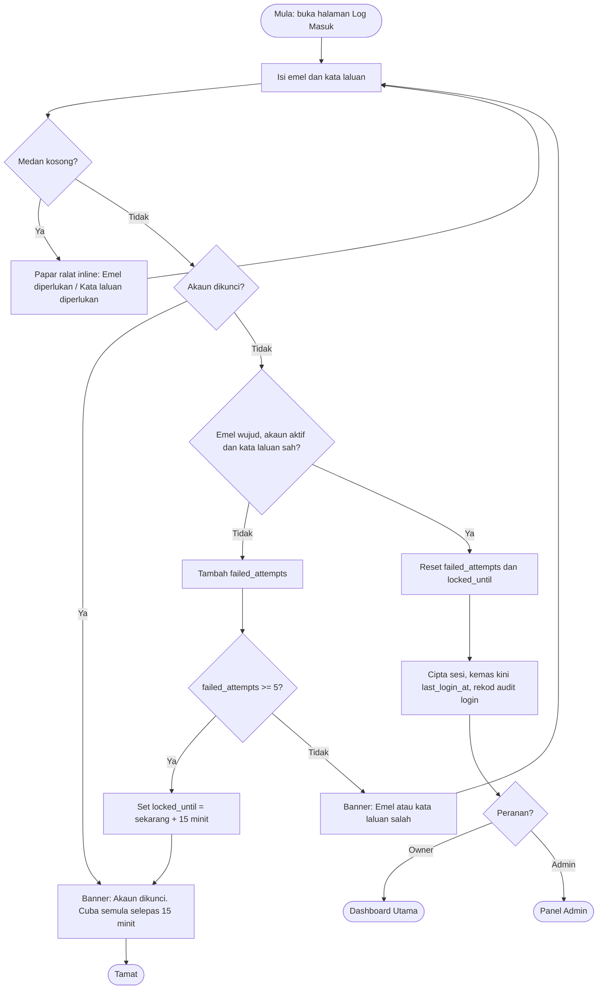

**Peraturan khas**
- Ralat medan kosong dan banner kelayakan salah **tidak dipaparkan serentak**.
- Mesej ralat tidak mendedahkan sama ada emel wujud.
- Akaun `inactive` mendapat mesej generik yang sama seperti kelayakan salah.
- Butang menunjukkan spinner dan dilumpuhkan semasa permintaan berjalan.

---

## WF-02: Lupa dan Reset Kata Laluan

| Perkara | Butiran |
|---|---|
| Pencetus | Pengguna klik "Lupa kata laluan?" |
| Keputusan | Kata laluan baharu ditetapkan; semua sesi lama ditamatkan |
| Peraturan | FR-AUTH-06, FR-AUTH-07; token 60 minit, sekali guna |

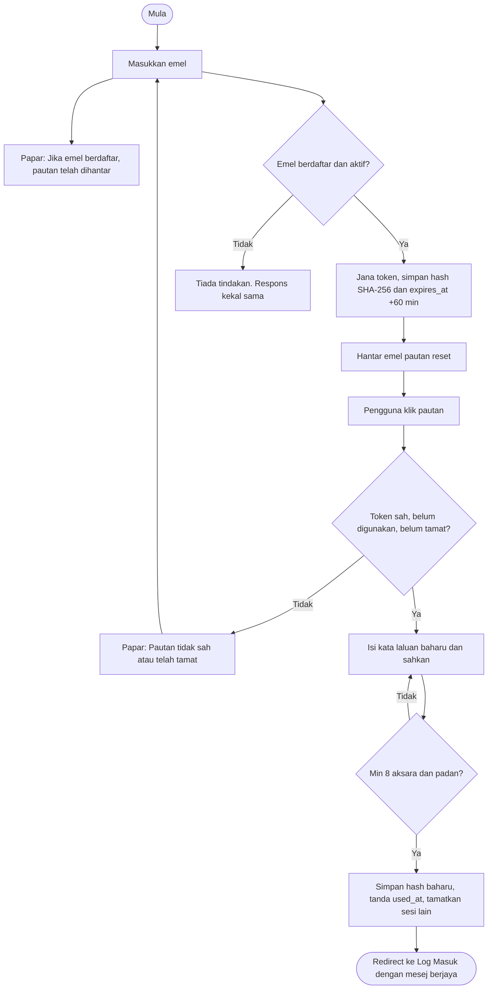

---

## WF-03: Sync Data Automatik (WooCommerce)

| Perkara | Butiran |
|---|---|
| Pencetus | Scheduler pada `sync_time` (lalai 02:00) |
| Prasyarat | Connector `active` dengan kelayakan sah |
| Keputusan | Ringkasan harian dan bulanan dikemas kini; `last_synced_at` dikemas kini |
| Peraturan | BR12, BR13, BR17 hingga BR20, BR22; FR-SYNC-01 hingga 07 |

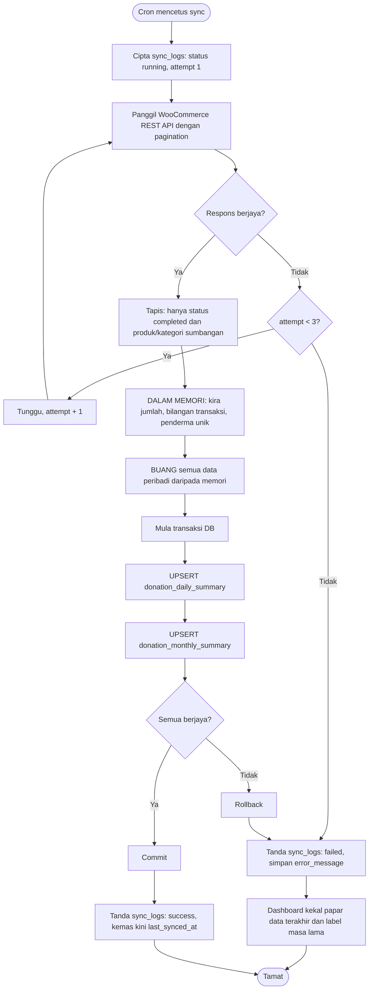

**Peraturan khas**
- Tarik semula sekurang-kurangnya **30 hari terkini** setiap larian supaya perubahan status (contoh refund) diambil kira.
- Larian pertama (backfill) menarik sehingga 12 bulan sejarah.
- Hanya satu larian sync bagi satu connector pada satu masa (kunci/lock).
- Kandungan `error_message` tidak boleh mengandungi data peribadi atau rahsia.

---

## WF-04: Sync Manual (Sync Sekarang)

| Perkara | Butiran |
|---|---|
| Pencetus | Admin klik **Sync Sekarang** pada Tetapan Connector |
| Peraturan | FR-CONN-05 |

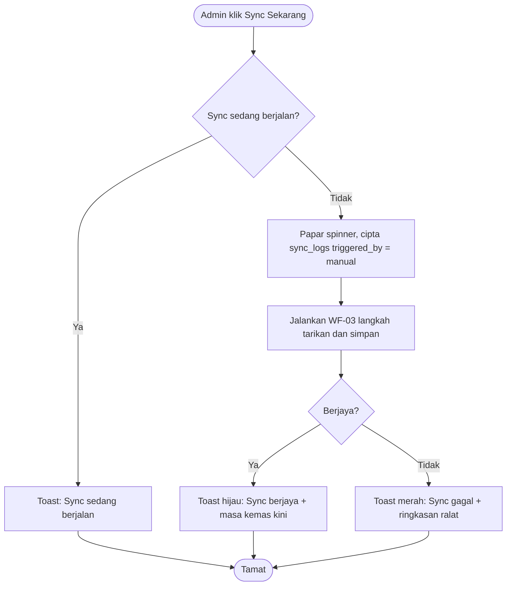

---

## WF-05: Lihat Dashboard dan Tukar Tempoh

| Perkara | Butiran |
|---|---|
| Pencetus | Owner log masuk atau menukar penapis |
| Prasyarat | Peranan `owner` |
| Peraturan | FR-DASH-01 hingga 10, FR-TBQ-01 hingga 05 |

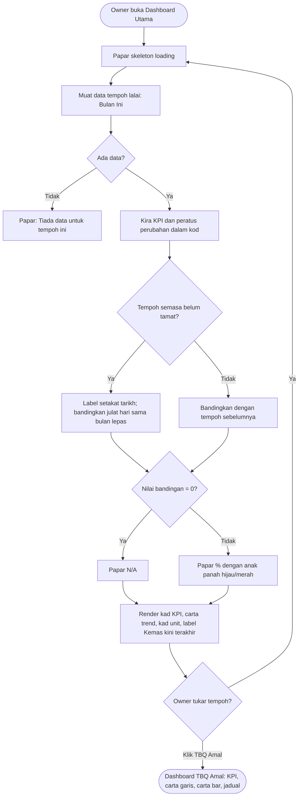

**Pengendalian ralat:** jika API dalaman gagal, papar kad ralat dengan butang **Cuba Lagi**; data lama tidak dipaparkan sebagai baharu.

---

## WF-06: Konfigurasi Connector

| Perkara | Butiran |
|---|---|
| Pencetus | Admin membuka Tetapan Connector |
| Peraturan | FR-CONN-01 hingga 04 |

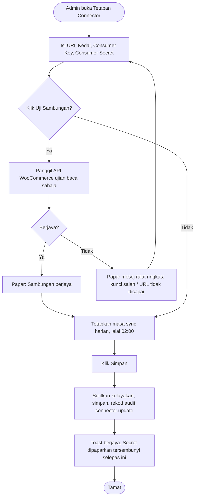

---

## WF-07: Pengurusan Pengguna

| Perkara | Butiran |
|---|---|
| Pelaku | Admin, Owner |
| Peraturan | FR-USR-01 hingga 08, BR01, BR02, BR06 |

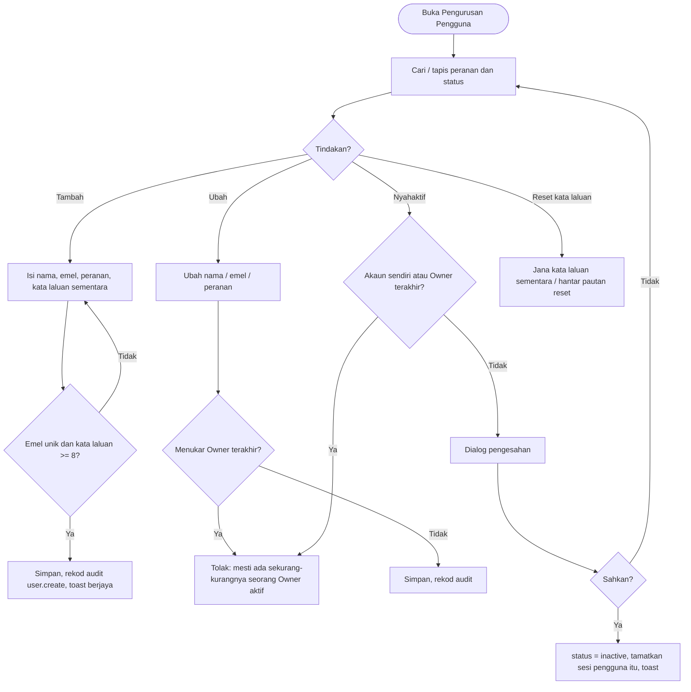

---

## WF-08: Sesi dan Tamat Masa

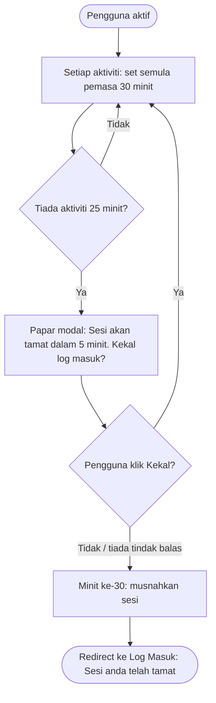

---

## WF-09: Tukar Kata Laluan (Profil Saya)

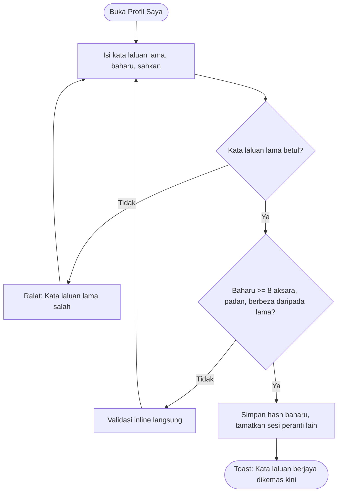

---

## WF-10: Kawalan Akses (Route Guard)

| Halaman/Fungsi | Owner | Admin | Tiada sesi |
|---|---|---|---|
| Dashboard Utama, Dashboard TBQ Amal | Benarkan | **403** | Log Masuk |
| Panel Admin, Tetapan Connector | **403** | Benarkan | Log Masuk |
| Pengurusan Pengguna | Benarkan | Benarkan | Log Masuk |
| Profil Saya | Benarkan | Benarkan | Log Masuk |
| API data prestasi (`/api/dashboard/*`) | Benarkan | **403** | 401 |

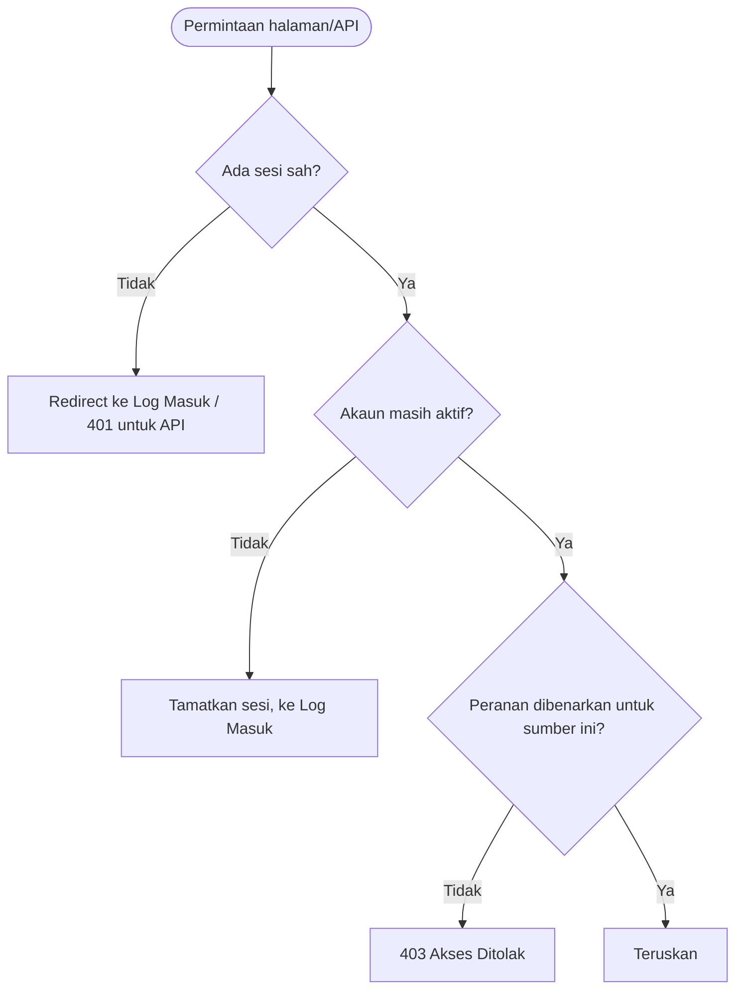

**Peraturan:** semakan dibuat di **server** pada setiap permintaan; menyembunyikan menu sahaja tidak mencukupi.

---

## WF-11: Aliran Data Hujung ke Hujung

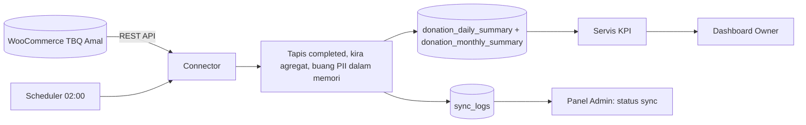

| Peringkat | Input | Proses | Output |
|---|---|---|---|
| 1. Tarik | Transaksi WooCommerce | Panggil API, pagination | Data mentah dalam memori |
| 2. Tapis dan agregat | Data mentah | Hanya `completed`; kira jumlah, transaksi, penderma unik | Nilai agregat |
| 3. Buang PII | Data mentah | Padam daripada memori | Tiada data peribadi |
| 4. Simpan | Nilai agregat | Upsert dalam transaksi DB | Ringkasan harian dan bulanan |
| 5. Rekod | Keputusan larian | Tulis `sync_logs`, kemas kini `last_synced_at` | Jejak sync |
| 6. Paparan | Ringkasan | Kira KPI dan % | Kad, carta, jadual |

---

## Keadaan Ralat dan Mesej Standard

| Keadaan | Mesej (BM) | Tindakan sistem |
|---|---|---|
| Kelayakan salah | Emel atau kata laluan salah | Tambah failed_attempts |
| Akaun dikunci | Akaun dikunci. Cuba semula selepas 15 minit | Lumpuhkan butang |
| Sesi tamat | Sesi anda telah tamat. Sila log masuk semula | Redirect |
| Tiada kebenaran | Anda tiada kebenaran untuk mengakses halaman ini | 403 |
| Halaman tiada | Halaman tidak dijumpai | 404 |
| Tiada data | Tiada data untuk tempoh ini | Keadaan kosong |
| Sync gagal | Sync gagal. Data terakhir dikemas kini pada [masa] | Log + label |
| Uji sambungan gagal | Sambungan gagal. Semak URL dan kunci API | Kekal di borang |
| Bandingan sifar | N/A | Papar N/A |

---

## Ringkasan Peranan dan Workflow

| Peranan | Workflow terlibat |
|---|---|
| Owner | WF-01, 02, 05, 07, 08, 09, 10 |
| Admin | WF-01, 02, 04, 06, 07, 08, 09, 10 |
| Sistem (cron) | WF-03, 11 |
